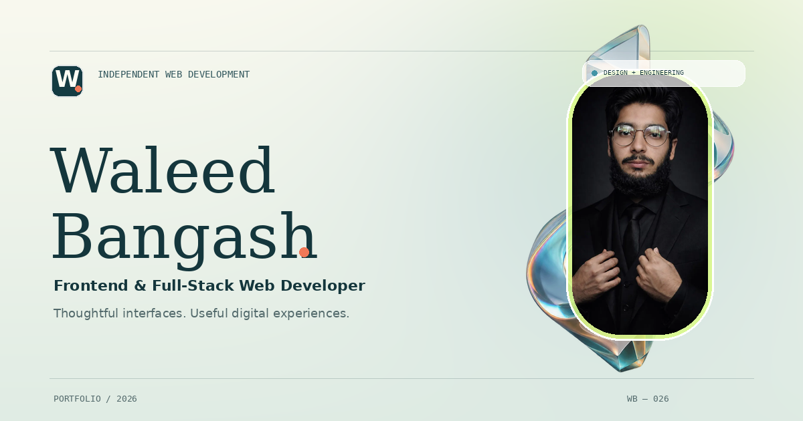

# Waleed Bangash — Developer Portfolio

<p align="center">
  
</p>

<p align="center">
  <strong>Design that draws you in. Engineering that keeps it useful.</strong>
  <br />
  A personal portfolio showcasing frontend and full-stack web work through considered visual design, purposeful interaction, and practical engineering.
</p>

---

## Overview

This portfolio presents selected website builds and concepts through an editorial layout, responsive project storytelling, and a distinctive sculptural visual layer. It is designed to show how a strong visual direction and thoughtful implementation can work together without sacrificing clarity, usability, or accessibility.

## Featured projects

| Project | Description | Live experience |
| --- | --- | --- |
| **Nexora One** | Furniture and interiors storefront focused on curated collections, showroom discovery, and consultation pathways. | [Open website](https://nexora-one-dusky.vercel.app) |
| **Cowboy Burger** | Interactive food-brand demo with a bold hero, scroll-led storytelling, menu exploration, and clear order or visit pathways. | [Open demo](https://cowboy.infinityfree.io) · [Source code](https://github.com/waleedBangash056/arena-cowboy-burger) |
| **Café Aroma** | Hospitality website concept featuring warm coffee imagery, menu discovery, and visit-oriented actions. | [Open concept](https://waleed-cafe.infinityfreeapp.com) |
| **Smash & Sizzle** | Restaurant website demo with food-first visual storytelling and clear paths to explore the restaurant experience. | [Open demo](https://smash-and-sizzle-demo.vercel.app) · [Source code](https://github.com/waleedBangash056/fast-food-ordering-system) |

The Smash & Sizzle card uses the genuine screenshot supplied for this update, optimized into wide and small WebP assets while retaining the original page composition.

## Highlights

- **Scroll-driven visual story** — a persistent crystal artwork travels through the page with CSS perspective transforms and chapter-aware emphasis.
- **Selective glassmorphism** — translucent material effects are reserved for key surfaces instead of being applied indiscriminately.
- **Smoked-crystal project stories** — project explanations use a high-contrast petrol surface, restrained project-specific accent lighting, clear typography, and simple non-nested content; glass is reserved for small interactive surfaces.
- **Purposeful interactions** — selected project, process, and contact surfaces use subtle depth and pointer interactions.
- **Transparent talking-avatar introduction** — the hero composites a full-body, alpha-channel WebM of Waleed into a borderless 3D-inspired studio. The real video carries the synchronized facial performance, gestures, and voice; the site never substitutes browser speech over a static portrait.
- **Responsive layout** — content adapts to desktop, tablet, and mobile viewport sizes.
- **Accessible motion controls** — includes a user-facing motion toggle, respects the operating system's reduced-motion preference, and provides reduced-transparency and forced-colors fallbacks.
- **Lightweight static output** — no frontend framework, backend service, runtime JavaScript package dependencies, analytics, or external font/CDN requests are required to serve the built site.
- **Centralized project content** — profile details and featured project entries are maintained in `data/site-data.json`.

> **Implementation note:** The crystal is transparent artwork animated on a CSS perspective-transformed image plane. It is not a volumetric WebGL or GLB model. This preserves the intended artwork silhouette without shipping the earlier experimental mesh.

## Technology

- Semantic HTML
- Modern CSS, including perspective transforms, responsive layout, and material effects
- TypeScript for interaction, scroll-story behavior, and talking-avatar video playback
- CSS perspective, transforms, and keyframe animations for sequenced motion
- Native WebM alpha-video playback, with a WebGL canvas keying fallback for Safari's opaque WebM handling and optional English WebVTT captions
- Node.js-based static build scripts
- npm for development tooling and tests

## Run locally

### Requirements

- [Node.js](https://nodejs.org/) 22 or newer
- npm, included with Node.js

### Setup

```bash
git clone https://github.com/waleedBangash056/waleed-bangash-portfolio.git
cd waleed-bangash-portfolio
npm install
npm run dev
```

The development server prints its local address. By default, it is `http://127.0.0.1:4173`.

## Useful commands

| Command | Purpose |
| --- | --- |
| `npm install` | Install the project's development tooling. |
| `npm run dev` | Build the site and start the local development server. |
| `npm run build` | Generate the deployable static site in `dist/`. |
| `npm run preview` | Serve the most recently built `dist/` output locally. |
| `npm test` | Build the site and run the automated tests. |
| `npm run check` | Run the TypeScript check without emitting files. |

## Project structure

```text
.
├── data/
│   ├── site-data.json          # Profile, contact details, and project content
│   └── intro-media-manifest.json  # Validated media hashes and alpha-plane QA record
├── design-assets/
│   └── smash-and-sizzle-cover.svg  # Design exploration; the page uses the supplied screenshot
├── public/
│   ├── .htaccess               # Shared-host MIME types for video and WebP
│   └── assets/                 # Images, icons, studio background, and avatar video assets
├── src/
│   ├── index.template.html     # Page structure and content placeholders
│   ├── main.ts                 # Motion controls and pointer interactions
│   ├── scroll-story.ts         # Scroll-linked artwork and reveal behavior
│   └── scene.ts                # Experimental scene code; excluded from production build
├── styles/
│   ├── tokens.css              # Shared design tokens
│   └── site.css                # Layout, materials, effects, and responsive styles
├── tests/                      # Build-output and site-data tests
├── tools/                      # Static build and local-server scripts
├── docs/                       # Design decisions, implementation notes, and verification records
├── screenshots/                # Captured layout references and verification artifacts
├── package.json
├── tsconfig.json
└── README.md
```

The `data/site-data.json` file is the main place to update profile details, the four introduction caption segments (`profile.introSegments`), and featured project entries. The build copies the assets and styles, validates the talking-avatar files against `data/intro-media-manifest.json`, and compiles the TypeScript. The supplied Smash & Sizzle screenshot is stored as optimized `public/assets/smash-and-sizzle.webp` and `smash-and-sizzle-640.webp`. The speaking avatar uses `public/assets/waleed-introduction-alpha.webm`; its matching original MP4 is retained for Safari's WebGL canvas-keying fallback, and `public/assets/waleed-avatar-poster.webp` is the idle standing pose. The manifest binds the exact reviewed files to SHA-256 digests so a stale or accidental media replacement disables playback instead of silently shipping an unverified avatar.

## Build and deploy

Generate the production website:

```bash
npm install
npm run build
```

The deployable website is written to `dist/`. For a static host such as InfinityFree, upload the **contents** of `dist/` to the domain's web root (commonly `htdocs/`). The web root should contain `index.html` alongside the `app/`, `assets/`, and `styles/` folders. Do not upload the source project as a nested directory in place of those files.

The repository stores the source project. The generated `dist/` directory is excluded by `.gitignore`, so build output does not need to be committed for normal source control.


## Work-section material and external project links

The project explanation panels use a near-opaque smoked-petrol surface rather than stacking multiple translucent boxes behind long-form text. Light ivory body text, muted pale-sage supporting text, a restrained per-project accent, and a single fine highlight preserve the portfolio’s material language without making readability depend on the background. The Nexora One primary action opens the exact `https://nexora-one-dusky.vercel.app` URL in the current tab; external source-code links remain in a new tab with `noopener noreferrer`.

This follows the principle that glass is a functional material, not decoration for every content block. The [Apple Human Interface Guidelines on materials](https://developer.apple.com/design/human-interface-guidelines/materials) recommend using Liquid Glass sparingly and avoiding it in the content layer; [Nielsen Norman Group’s glassmorphism guidance](https://www.nngroup.com/articles/glassmorphism/) highlights text-contrast risks; and [WCAG contrast guidance](https://www.w3.org/WAI/WCAG21/Understanding/contrast-minimum.html) defines a 4.5:1 minimum for ordinary text.

## Accessibility and motion

Motion is an enhancement, not a requirement for reading the content. The project includes a user-facing motion toggle, respects `prefers-reduced-motion`, and provides fallbacks for reduced transparency and forced-colors modes. Key information remains in document content rather than being conveyed only through animation.

## Transparent talking-avatar introduction

The hero's full-body avatar is composited into the studio scene without a video-player frame. The production asset is `public/assets/waleed-introduction-alpha.webm` (VP9 alpha video + Opus voice), and `public/assets/waleed-avatar-poster.webp` supplies the still standing pose before playback and after the introduction ends. The video starts only when the visitor activates the custom introduction control; the audio, lip movement, and gestures are part of the same video timeline.

The submitted Gemini video contained a gray checkerboard baked into the pixels rather than a real alpha channel. The shipped WebM is a processed cutout with an alpha plane. The original source MP4 is kept as `public/assets/waleed-introduction-source.mp4` for a Safari fallback that keys the checkerboard into a transparent WebGL canvas, since Safari does not render VP8/VP9 WebM alpha consistently. The fallback is intentionally scoped to Safari; Chromium and Firefox use the alpha WebM directly. The site's CSS perspective architecture, floating glass planes, and floor treatment form the 3D-inspired environment behind the body cutout.

Media integrity is tracked in [`data/intro-media-manifest.json`](data/intro-media-manifest.json). The build verifies the reviewed files' SHA-256 hashes before it enables the player. If you replace or regenerate the video, re-run the alpha-channel checks and update the manifest only after confirming the new media actually contains transparency and synchronized sound. See [`docs/AVATAR-ALPHA-PIPELINE.md`](docs/AVATAR-ALPHA-PIPELINE.md) for the processing method, browser fallback, deployment considerations, and verification commands.

The static site has no runtime dependency on Gemini or any avatar provider. All video is hosted with the site, and no API credentials are included in frontend code. The full-body video is composited over an office background with an open architectural portal and a perspective floor grid; the video starts only after the visitor explicitly activates the introduction button.

## Contact

- **GitHub:** [@waleedBangash056](https://github.com/waleedBangash056)
- **LinkedIn:** [Waleed Ahmed Khan](https://www.linkedin.com/in/waleed-ahmed-khan-31807b3b1/)

For project enquiries, use the contact options on the portfolio website.

## License and asset rights

No open-source license is currently included. Unless a license is added, do not assume that others have permission to reuse, redistribute, or adapt this code. The images, logos, and branding shown in featured project entries may have separate rights and permissions; confirm those rights before publishing or reusing them.
